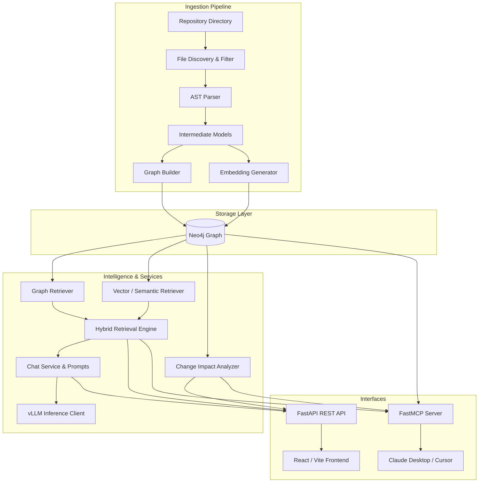

# RepoLens — AI Codebase Intelligence Platform

RepoLens is an AI-powered codebase intelligence platform that transforms Python repositories into searchable knowledge graphs. It enables developers to explore code architecture, trace dependencies, evaluate change impact, and ask natural language questions grounded in verified code facts.

```
                    ┌─────────────────────────────────────────┐
                    │            RepoLens Frontend            │
                    │   React 18 + TypeScript + Tailwind CSS  │
                    └────────────────────┬────────────────────┘
                                         │ REST API
                                         ▼
┌──────────────────┐        ┌─────────────────────────┐        ┌──────────────────┐
│    MCP Client    │        │     FastAPI Backend     │◄───────┤ External vLLM /  │
│ (Claude / Cursor)├───────►│  Retrieval & Reasoning  │        │ OpenAI Compatible│
└──────────────────┘  stdio └────────────┬────────────┘        └──────────────────┘
                                         │ Cypher / Vector
                                         ▼
                            ┌─────────────────────────┐
                            │      Neo4j Database     │
                            │   Knowledge Graph +     │
                            │    Vector Embeddings    │
                            └─────────────────────────┘
```

---

## Key Features

1. **Deterministic AST Parsing**: Structural analysis of Python source files extracting classes, functions, methods, docstrings, signatures, and static call sites without executing code.
2. **Neo4j Knowledge Graph**: Explicit graph representation (`CONTAINS`, `DEFINES`, `CALLS`, `INHERITS`, `IMPORTS`, `HAS_METHOD`) with uniqueness constraints and indexes.
3. **Change Impact Analysis**: Blast-radius computation identifying directly and indirectly affected functions and files across configurable traversal depths.
4. **Hybrid Retrieval**: Combines semantic vector similarity (Hugging Face embeddings), graph neighbor expansion, and keyword matching.
5. **vLLM / LLM Chat**: Codebase Q&A citing exact file paths and line ranges, with graceful fallback when inference is offline.
6. **Model Context Protocol (MCP)**: Native FastMCP server exposing tools (`search_code`, `get_symbol`, `trace_dependencies`, `impact_analysis`, `explain_architecture`) to Claude Desktop, Cursor, and other AI agents.
7. **Developer-First UI**: Dark-mode dashboard, interactive React Flow graph explorer, code viewer, and impact analyzer.

---

## Architecture Overview



---

## Tech Stack

| Layer | Technology |
|---|---|
| **Backend** | Python 3.11+, FastAPI, Uvicorn, Pydantic v2 |
| **Parsing** | Python `ast` module, `pathspec` for `.gitignore` |
| **Knowledge Graph** | Neo4j 5.20+ (APOC, Vector index) |
| **Embeddings** | Hugging Face `sentence-transformers` (`BAAI/bge-small-en-v1.5`) |
| **LLM Inference** | OpenAI-compatible endpoint (vLLM, Ollama, LocalAI) |
| **Agent Interface** | MCP (Model Context Protocol / FastMCP) |
| **Frontend** | React 18, TypeScript, Vite, Tailwind CSS, React Flow (`@xyflow/react`), Lucide |
| **Infrastructure** | Docker, Docker Compose |

---

## Quick Start with Docker

### 1. Clone & Configure Environment

```bash
git clone https://github.com/RanbeerReddy/RepoLens.git
cd RepoLens
cp .env.example .env
```

### 2. Run with Docker Compose

```bash
docker-compose up --build
```

Services will be accessible at:
- **Frontend**: [http://localhost:3000](http://localhost:3000)
- **FastAPI Backend (Swagger Docs)**: [http://localhost:8080/docs](http://localhost:8080/docs)
- **Neo4j Browser**: [http://localhost:7474](http://localhost:7474) (User: `neo4j`, Password: `repolens_dev_password`)

---

## Local Development Setup

### Backend Setup

```bash
cd backend
python3 -m venv .venv
source .venv/bin/activate
pip install -e ".[dev]"

# Ensure Neo4j is running locally or via Docker:
# docker run -d -p 7687:7687 -p 7474:7474 -e NEO4J_AUTH=neo4j/repolens_dev_password neo4j:5.20.0

# Start backend server
uvicorn app.main:app --host 0.0.0.0 --port 8080 --reload
```

### Frontend Setup

```bash
cd frontend
npm install
npm run dev
```
The Vite development server will start at [http://localhost:5173](http://localhost:5173).

---

## Connecting External LLM (vLLM)

RepoLens works with any OpenAI-compatible API endpoint:

```env
LLM_BASE_URL=http://localhost:8000/v1
LLM_API_KEY=not-needed
LLM_MODEL=meta-llama/Llama-3.1-8B-Instruct
LLM_TEMPERATURE=0.1
LLM_MAX_TOKENS=2048
```

> **Note**: If no LLM server is running, all non-LLM operations (ingestion, graph browsing, dependency tracing, change impact analysis, and hybrid retrieval) remain fully functional.

---

## Model Context Protocol (MCP) Setup

To connect Claude Desktop or Cursor to RepoLens:

### Claude Desktop Configuration (`claude_desktop_config.json`)

```json
{
  "mcpServers": {
    "repolens": {
      "command": "python",
      "args": ["-m", "app.mcp.server"],
      "cwd": "/path/to/RepoLens/backend",
      "env": {
        "NEO4J_URI": "bolt://localhost:7687",
        "NEO4J_USER": "neo4j",
        "NEO4J_PASSWORD": "repolens_dev_password"
      }
    }
  }
}
```

### Available MCP Tools

- `list_repositories`: List all registered repositories.
- `search_code`: Hybrid code search combining semantic similarity and graph context.
- `get_symbol`: Inspect symbol signatures, docstrings, source code, and neighbors.
- `trace_dependencies`: Traverse callers and callees with configurable depth.
- `impact_analysis`: Run static blast-radius analysis before making code modifications.
- `explain_architecture`: Structural summary and key module topology.

---

## API Reference

| Method | Endpoint | Description |
|---|---|---|
| `GET` | `/health` | Basic service health |
| `GET` | `/health/neo4j` | Neo4j connectivity status |
| `GET` | `/health/llm` | LLM endpoint status |
| `POST` | `/api/repositories` | Register local repository |
| `GET` | `/api/repositories` | List registered repositories |
| `GET` | `/api/repositories/{id}` | Get repository details |
| `DELETE` | `/api/repositories/{id}` | Delete repository & graph nodes |
| `POST` | `/api/repositories/{id}/ingest` | Ingest repository files |
| `POST` | `/api/repositories/{id}/search` | Hybrid code search |
| `GET` | `/api/repositories/{id}/symbols` | Search symbols |
| `GET` | `/api/repositories/{id}/graph` | Graph nodes & edges for visualization |
| `POST` | `/api/repositories/{id}/impact` | Change impact analysis |
| `POST` | `/api/repositories/{id}/chat` | Codebase Q&A chat |

---

## Running Tests

```bash
cd backend
pytest -v tests/unit
```

---

## License

Apache-2.0 License.
